<picture>
  <source media="(prefers-color-scheme: dark)" srcset="assets/header-dark.svg">
  
</picture>

I build AI that people talk to. The model is only half the job; the rest is making it quick, keeping the data honest and getting it into people's hands.

**Focus** &nbsp; Agents · tool use · RAG · context and memory · evals 
**Stack** &nbsp; Python · PyTorch · LangGraph · Microsoft Agent Framework · Azure AI Foundry · AWS · Docker · C#

[Portfolio](https://sudomuhammad.github.io) &nbsp;·&nbsp; [LinkedIn](https://www.linkedin.com/in/muhammaduzair94/)
